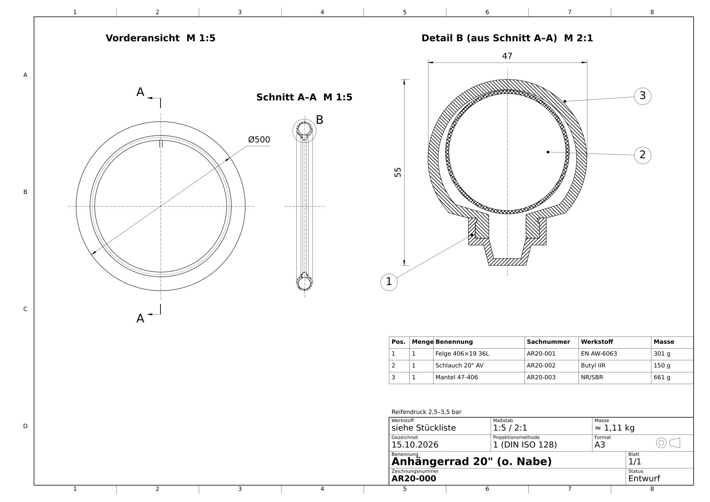

# Fahrradanhänger-Rad 20" (ETRTO 406): Felge, Schlauch und Mantel für SolidWorks

Kostengünstiges Standardrad für Kinder- und Lastenanhänger (ohne Nabe und Speichen):

| Pos. | Teil | Ausführung | Masse |
|---|---|---|---|
| 1 | Felge 406×19 | einwandig, Alu EN AW-6063 T6, Haken, 36 Loch, AV-Ventilloch | ≈ 301 g |
| 2 | Schlauch 20 × 1.75–2.125 | Butyl, Autoventil (AV) 35 mm | ≈ 150 g |
| 3 | Mantel 47-406 (20 × 1.75) | Drahtreifen, 30 TPI | ≈ 661 g |



## Inhalt

| Ordner/Datei | Inhalt |
|---|---|
| [`ANLEITUNG.md`](ANLEITUNG.md) | **Schritt-für-Schritt-Anleitung** für SolidWorks: Teile, Baugruppe, Zeichnungen, Dateien öffnen |
| `cad_step/` | 3D-Modelle als STEP (Teile + Baugruppe), in SolidWorks direkt zu öffnen |
| `solidworks_makros/Anhaengerrad20.bas` | VBA-Makro: erzeugt `.SLDPRT`, `.SLDASM` und Zeichnungsgerüste `.SLDDRW` |
| `zeichnungen/` | Bemaßte Zeichnungen DIN A3: **PDF** (ansehen), **DXF** (bearbeiten), PNG (Vorschau) |
| `skripte/` | Python-Quellen (CadQuery/matplotlib/ezdxf), aus denen STEP und Zeichnungen erzeugt werden |

## Neu erzeugen

```bash
pip install -r skripte/requirements.txt
cd skripte
python erzeuge_step.py          # STEP-Dateien, Massen, Kollisionsprüfung
python erzeuge_zeichnungen.py   # PDF/PNG/DXF-Zeichnungen
```

Alle Maße hängen am Wulstsitzradius `RB` in `skripte/geometrie.py`.
