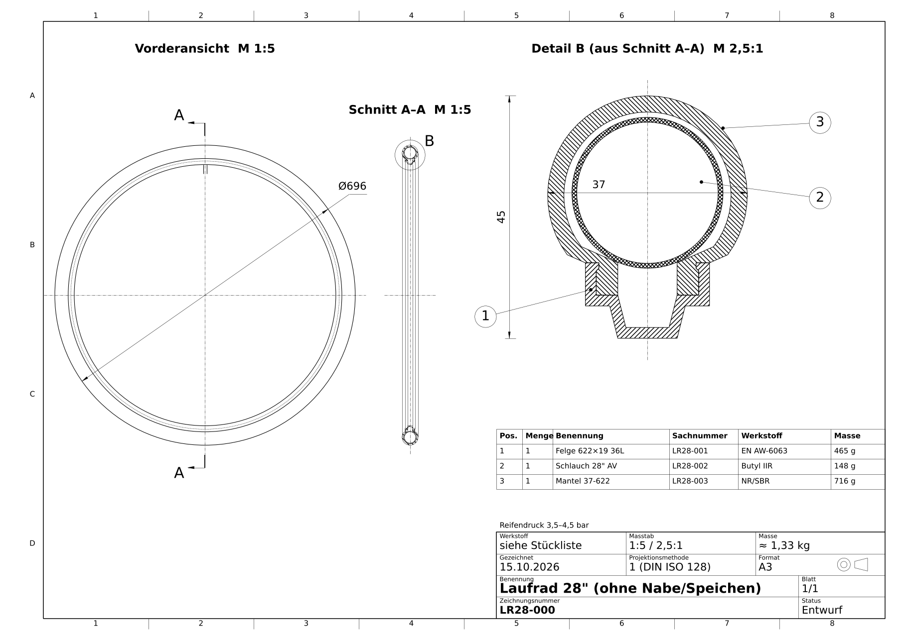

# Laufrad 28" (ETRTO 622): Felge, Schlauch und Mantel für SolidWorks

Kostengünstige Standardausführung eines 28"-Laufrads (City/Trekking) ohne Nabe und Speichen:

| Pos. | Teil | Ausführung | Masse |
|---|---|---|---|
| 1 | Felge 622×19 | einwandig, Alu EN AW-6063 T6, Haken, 36 Loch, AV-Ventilloch | ≈ 465 g |
| 2 | Schlauch 28" | Butyl, Autoventil (AV) 40 mm | ≈ 148 g |
| 3 | Mantel 37-622 (28×1.40) | Drahtreifen, 50 TPI | ≈ 716 g |



## Inhalt

| Ordner/Datei | Inhalt |
|---|---|
| [`ANLEITUNG.md`](ANLEITUNG.md) | **Schritt-für-Schritt-Anleitung** für SolidWorks: Teile modellieren, Baugruppe, Zeichnungen |
| `cad_step/` | Fertige 3D-Modelle als STEP: `Felge.step`, `Schlauch.step`, `Mantel.step`, `Laufrad_Baugruppe.step` |
| `solidworks_makros/Laufrad28.bas` | VBA-Makro: erzeugt in SolidWorks alle `.SLDPRT`, die `.SLDASM` und Zeichnungsgerüste `.SLDDRW` |
| `zeichnungen/` | Bemaßte Soll-Zeichnungen (DIN A3, PDF + PNG), `LR28_Zeichnungssatz.pdf` = alle 4 Blätter |
| `skripte/` | Python-Quellen (CadQuery/matplotlib), aus denen STEP und Zeichnungen erzeugt werden |

## Schnellstart

- **Nur anschauen/weiterverwenden:** `cad_step/Laufrad_Baugruppe.step` in SolidWorks öffnen.
- **Native SolidWorks-Dateien automatisch:** Makro importieren und ausführen (ANLEITUNG Kap. 7).
- **Selbst modellieren (Lernweg):** ANLEITUNG Kap. 1–6.

## Neu erzeugen

```bash
pip install -r skripte/requirements.txt
cd skripte
python erzeuge_step.py          # STEP-Dateien + Kollisionsprüfung
python erzeuge_zeichnungen.py   # PDF/PNG-Zeichnungen
```

`erzeuge_step.py` prüft die drei Teile paarweise auf Durchdringung; das Ergebnis ist überall 0 mm³.
